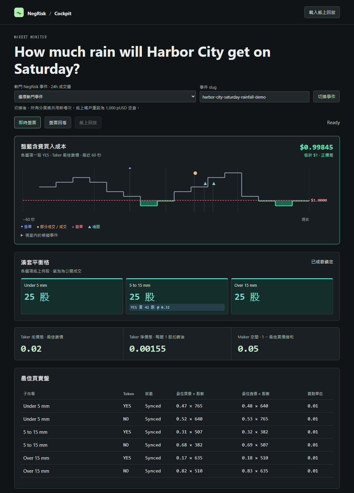

# Polymarket NegRisk Monitor

Polymarket lists each outcome of a multi-outcome event in a separate order book. NegRisk Monitor brings those books into one local dashboard so you can see what it costs to buy one YES share per outcome. A complete set pays out 1 pUSD. The dashboard tracks the cost against that payout, including taker fees when a verified fee rate is available.

Use public market data to simulate orders, queueing, cancellations, and fills on the remaining outcomes. Orders and balances stay in the local simulator.

## Quick start

With Rust and Cargo installed, run this from the repository directory.

```sh
cargo run --locked -- cockpit
```

Open <http://127.0.0.1:8080>. Choose a popular event or enter its slug (the event identifier in its Polymarket URL) and click **切換事件** (Switch event). The dashboard labels are in Traditional Chinese. Live monitoring needs an internet connection to Polymarket. Press Ctrl+C to stop.

## Demo



The screenshot shows the Cockpit with synthetic market data. The dashed $1 line marks the payout for a complete set. The chart marks simulated orders and fills, and the tiles show 25 simulated shares per outcome after the simulated orders fill across all three outcomes.

## Command line

```sh
cargo run --locked -- cockpit EVENT_SLUG
cargo run --locked -- watch EVENT_SLUG
cargo run --locked -- list --offset 100
```

Replace `EVENT_SLUG` with a Polymarket event slug. Add `--once` to `watch` to exit after successfully writing the first synchronized snapshot. The `list` command requests 100 events per page by default and prints only eligible NegRisk events.

## Documentation

- [Cockpit guide](docs/cockpit.md) covers the simulated account, spread metrics, and replay.
- [Paper execution rules](docs/paper-execution.md) explain fill, cancellation, and disconnect behavior.
- [Order book synchronization](docs/synchronization.md) describes readiness, recovery, and the library interface.
- [Paper trading API](src/paper/mod.rs) and [known issues](BACKLOG.md) are available for developers. Run the test suite with `cargo test --locked`.

## License

[MIT](LICENSE)
